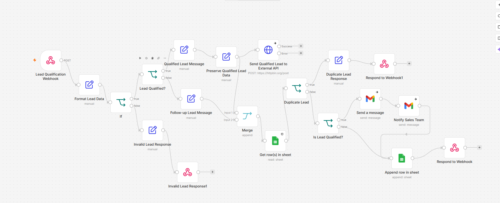

# Lead Qualification & Email Automation with n8n

An end-to-end lead management workflow built using **n8n, Google Sheets, Gmail, and Webhooks**.

## Project Overview

This automation streamlines lead intake, validation, qualification, duplicate detection, tracking, and email communication.

It reduces manual work and ensures qualified leads are communicated to the sales team promptly.

## Key Features

- Webhook-based lead registration
- Required-field validation
- Automatic lead qualification
- Duplicate email detection
- Google Sheets lead tracking
- Personalized customer confirmation emails
- Internal sales-team notifications
- Error handling for email failures
- Automated webhook responses

## Technologies Used

- n8n
- Google Sheets
- Gmail API
- OAuth2
- Webhooks
- JSON
- HTTP requests

## Workflow

1. Receive customer information through a webhook.
2. Validate required lead fields.
3. Qualify the lead based on budget and product criteria.
4. Check for duplicate email addresses.
5. Save valid, new leads in Google Sheets.
6. Send confirmation emails to qualified customers.
7. Notify the internal sales team.
8. Return a response to the webhook.

## Email Automation

**Qualified leads:**
- Receive a personalized confirmation email.
- Trigger an internal sales notification.
- Get recorded in Google Sheets.

**Not-qualified leads:**
- Get recorded in Google Sheets.
- Do not trigger qualified-lead notifications.

**Invalid leads:**
- Receive an error response.
- Are excluded from the lead tracker.

## Testing

Successfully tested:
- Qualified lead submission
- Not-qualified lead submission
- Invalid lead submission
- Duplicate lead detection
- End-to-end email and spreadsheet integration

## Business Value

- Reduces manual lead processing.
- Improves lead tracking accuracy.
- Prevents duplicate records.
- Speeds up sales-team communication.
- Improves consistency in customer communication.

## Workflow Screenshots

### Complete n8n Workflow

### Customer Confirmation Email

### Internal Sales Notification

### Qualified Lead Test

### Unqualified Lead Test

## Project Structure

- `workflow/` - Sanitized n8n workflow JSON
- `docs/` - Project documentation
- `screenshots/` - Workflow and execution screenshots

## Author

**Aysha Akter Mahin**

Automation Engineering Portfolio Project
